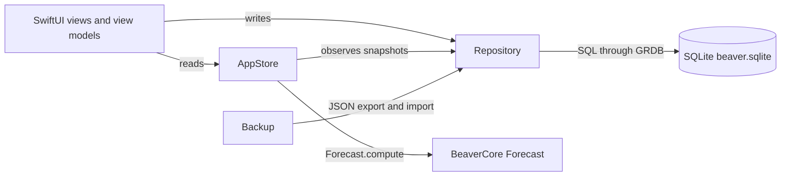

# Beaver architecture

This document describes the code as it is today. Where the code differs from `SPEC.md`, the last section says so.

## 1. Overview

Beaver has three layers. Each layer depends only on the layers below it.

**BeaverCore** (`Packages/BeaverCore`) is a pure Swift package. It imports Foundation only: no SwiftUI, no GRDB, no UIKit. It holds the value types and the forecast engine. It has no storage and no clock. The caller passes in "today".

**The Data layer** (`Beaver/Data`) is the only code that uses GRDB. `AppDatabase` owns the SQLite connection. `Repository` runs all SQL. `AppStore` observes the database and recomputes the forecast. `Backup` exports and imports the whole database as JSON. Record types map between database rows and BeaverCore values.

**The SwiftUI feature modules** (`Beaver/App`, `Beaver/Features`, `Beaver/Shared`) show state and send user actions. Views read `AppStore` from the environment and write through `Repository`. Testable logic sits in view models, which are plain Swift over BeaverCore values. No view imports GRDB.



## 2. BeaverCore

**Money and dates.** `Money` wraps an `Int` number of cents. There is no `Double` in stored or calculated money. Amounts are formatted only in the UI. `LocalDate` and `LocalTime` are wall-clock values. Date arithmetic uses integer civil-date code with Monday as the first weekday. `Calendar` is used only at the UI edge (`LocalDate.today(in:)`). A shift that starts at 18:00 stays at 18:00 across daylight saving changes.

**Main types.**
- Pay: `RateCard` (an ordered list of `RateRule`, each with a `DaySelector`, an optional `ClockWindow`, a band name and a rate), `Shift` and `ShiftStatus`, `ShiftPay`, `IncomeSource` and `IncomeKind` (`hourly` or `fixed`), `PaySchedule` (weekly, fortnightly, monthly), `TaxMethod`, `WithholdingTable` and `WithholdingRow`, `Template` and `TemplateShift`, `TemplateExpander`, `PayReceived`.
- Calendar facts: `Weekday`, `DateRange`, `Holiday`, `UnavailableRange`.
- Bills: `Bill`, `Cadence`, `BillPayment`, `BillOccurrence`, `BillStatus`, `BillCategory`.
- Spending and goals: `Expense`, `SpendCategory`, `WeekSpendTotal`, `Spending`, `Goal`, `Deposit`.
- Hours: `FortnightLimit`, `HoursLimits`, `HoursWarning`.
- Input and output: `ForecastInput` (all state in one value), `Forecast`, `WeekRow`, `PayEvent`, `SuggestedSplit`, `SplitLine`, `SplitKind`, `DemoData`.

**How the forecast is computed** (`Forecast.compute(_:)`):

1. **Window.** From the Monday of `today` to the end of the deadline week of the primary goal. With no deadline, the window is 26 weeks. The primary goal is `primaryGoalID`, or else the first goal.
2. **Rate cards to shift pay.** `ShiftPay.calculate` walks each shift minute by minute. Each minute takes the band of its own date and clock time, and a public holiday band overrides the rest. The result is the gross in cents, using exact integer rounding, plus band hours in hundredths. Cancelled shifts earn nothing.
3. **Shift pay to period pay.** Shifts are summed per pay period. A period with no shift rows falls back to the source's default template, skipping unavailable dates and applying public holidays.
4. **Withholding.** The tax method turns period gross into tax. A withholding table computes `x = floor(gross dollars) + 0.99`, then `max(0, roundHalfUp(a·x − b))` in whole dollars. Fortnightly pay applies the weekly table to half the gross and doubles the result.
5. **Pay events.** Each payday in the window becomes a `PayEvent`. A logged `PayReceived` for that payday replaces the estimate and is marked as actual.
6. **Bills to occurrences.** `Bill.occurrences` generates due dates from the anchor. A paid occurrence keeps its own paid amount.
7. **Spending.** Past weeks use recorded spending. A week total replaces that week's entries. The current and future weeks use the living budget.
8. **Weeks.** Each `WeekRow` has pay events, bills, living and `surplus = income − bills − living`. The deadline week counts pay events and bills dated on or before the deadline. Living counts as a full week. The what-if `extraWeeklyIncome` is added to every week.
9. **Goals.** `projected = deposits + Σ surplus`. `gap = projected − target`. Required per remaining payday = (target − deposits) ÷ paydays from today to the deadline, rounded half up.
10. **Suggested split.** For the next payday, funds are allocated in order: bills due before the following payday, the living budget for those days, the sinking fund (annual cost of non-weekly bills × days ÷ 365), the goal requirement, then buffer. A shortfall is shown as `fromBuffer`.

## 3. Data layer

**Database.** `AppDatabase` opens a `DatabasePool` at `Application Support/beaver.sqlite`. Tests and previews use an in-memory `DatabaseQueue`. Foreign keys are on.

**Tables.** There is one migration, `v1_initial`, which creates 17 tables: `setting`, `rate_card`, `withholding_table`, `income_source`, `template`, `template_shift`, `shift`, `pay_received`, `holiday`, `unavailable`, `hours_limit`, `bill`, `bill_payment`, `expense`, `week_spend_total`, `goal` and `deposit`.

Conventions:
- Dates and times are ISO text (`YYYY-MM-DD`, `HH:mm`).
- Money is `INTEGER` cents in `*_cents` columns. Booleans are `INTEGER` 0 or 1.
- The JSON columns `rules_json`, `rows_json`, `schedule_json`, `tax_method_json` and `cadence_json` hold Codable core values.
- Child tables cascade on delete. `income_source.rate_card_id` is set to null instead.
- `CHECK` constraints cover `kind`, `status` and `weekday`. Indexes cover `shift` and `expense` dates.

**Migrations.** Migrations go through `DatabaseMigrator` and are append-only. Any schema change needs a new migration. `v1_initial` also inserts the built-in withholding table `au-scale2-weekly` with `builtin = 1`. The engine already has that table, so the repository never exposes it for editing or deletion.

**Records to core types.** Record types in `Beaver/Data/Records/` map to BeaverCore values. For example, `IncomeSourceRecord(source)` builds a row and `core()` reads one back. The engine never sees a record type. An id of `0` means new. SQLite assigns the id, and a non-zero id is stored as given. Every `Repository.save` returns the stored value.

**Settings.** The `setting` table holds JSON values under the keys `currency`, `timeZone`, `onboardingDone`, `lastExportAt`, `primaryGoalId` and `livingBudgetCents`. A missing key reads as its default. A fresh database has zero rows.

**Observation.** `AppStore` is `@Observable` and `@MainActor`. Its initializer reads the database synchronously, so the first frame is correct. `run()`, started from `.task` on the root view, consumes `Repository.observeSnapshot`. That is a GRDB `ValueObservation` over settings and the engine input. Each change recomputes `Forecast.compute`. "Today" comes from the settings time zone through an injected clock. `refreshToday()` moves the window after midnight. `hoursLimits()` is not part of `ForecastInput`, so the Week tab loads it separately. `extraWeeklyIncome` lives in memory only.

**Backup format.** Export writes one JSON file, `BackupDocument`. It contains `schemaVersion` (currently `1`), `appVersion`, `exportedAt` and `tables`, which has one array per table. Export records `lastExportAt` and reads all tables in one transaction, so the file already contains the new timestamp.

Import reads only `schemaVersion` first:
- A version other than `1` (newer, zero or negative) fails with `unsupportedVersion`. Nothing changes.
- Non-JSON input fails with `notABackup`.
- Broken content or a broken foreign key fails with `corrupt`.

A valid import replaces all data in one transaction and rolls back on any failure. The built-in withholding table is re-inserted if the backup lacks it.

**Fresh install.** A fresh install is empty: zero rows, `onboardingDone` false, and no seeding at launch. `Repository.loadDemoData()` wipes the data and loads the fictional "Sam" from `DemoData`. Its only runtime caller is Settings → Load demo data, after confirmation. The other call sites are SwiftUI previews and tests. The demo sets `onboardingDone` to true.

## 4. Features

Each folder under `Beaver/Features/` is one area of the app.

- **Onboarding.** A seven-step first-run and re-run flow. It writes only currency, time zone, living budget and the finish flag. Other data is added through editors shown as sheets. It also offers restore from a backup file.
- **Week.** The home tab. It shows the ahead or behind headline, goal progress, this week's pay, bills due before the next payday, the living budget with quick expense entry, and banners for danger weeks, hours limits and backup reminders.
- **Roster.** Week picker and shift list. It covers add and edit shift, copy last week, apply template, save week as template and log pay.
- **Money.** Bills grouped under payday headers, with overdue items pinned to the top, plus a monthly view. Also spending with week totals, and goals with deposits.
- **Plan.** The forecast table with danger weeks highlighted. It has what-if controls for the living budget and extra weekly income.
- **Settings.** Income sources, withholding tables, holidays, unavailable ranges, hours limits, currency and time zone, re-run setup, backup export and import, erase, demo load and the local payday reminder.
- **Editors.** Shared forms used by the other folders: income source, rate card, template, bill, goal, limits and money field. Each form validates inline. `MoneyParser` turns text into cents without `Double`.

Shared UI helpers live in `Beaver/Shared`. `Beaver/App` holds the app entry point, `AppModel` and `MainTabView`.

## 5. Testing

**Golden tests.** The SPEC §6 cases are in `Packages/BeaverCore/Tests/BeaverCoreTests/GoldenTests.swift`. Edge cases are in `EdgeCaseTests.swift` in the same folder. Both use Swift Testing (`@Test`).

**App tests.** `BeaverTests/` holds the data-layer tests, which use an in-memory database, and the backup round-trip tests. It also has view-model tests: `WeekPlanTests`, `RosterTests`, `EditorsTests`, `MoneyTabTests`, `OnboardingTests`, `SettingsTests` and `SmokeTests`.

**Commands.**

```sh
cd Packages/BeaverCore && swift test

xcodegen generate
xcodebuild -project Beaver.xcodeproj -scheme Beaver \
  -destination 'platform=iOS Simulator,name=<an installed iPhone simulator>' test
```

`swift test` needs no simulator. `xcodebuild test` runs the app test target, so run `xcodegen generate` first. `Beaver.xcodeproj` is generated and not committed.

**Import rule.** `scripts/check-core-imports.sh` fails if any file under `Packages/BeaverCore/Sources` imports anything other than Foundation. Run it before you open a pull request.

## 6. Privacy by design

- **No network.** The app has no networking code. GRDB is the only third-party dependency.
- **No analytics, accounts or bank connections.** Nothing is sent off the device.
- **Local storage.** Data stays in SQLite under Application Support. A backup is a file that the user creates and chooses where to keep.
- **Local notifications only.** The payday reminder is off by default. Its flag is stored in `UserDefaults`, not in the database.
- **Public repository, no personal data.** The repository holds no personal financial data, no real employer rates and no bank statements. Tests, previews and demo data use only the fictional "Sam" at "Example Bar".
- **Sideloading identity.** The bundle ID comes from `BEAVER_BUNDLE_ID`. Each person can set it in the git-ignored `Config/Local.xcconfig`.

## Differences from SPEC.md

- **Date arithmetic.** SPEC §1 says to calculate with a `Calendar` in the user's time zone. The code uses its own integer date arithmetic, and `Calendar` appears only at the UI edge. See `DECISIONS.md`.
- **Bill amount changes.** SPEC §2.6 applies an edit from the next occurrence on. The core has no amount history, so every unpaid occurrence, including overdue ones, takes the new amount. Paid occurrences keep their amount.
- **Rate card gaps.** SPEC §2.2 says the editor shows gaps. The editor warns but does not block saving. Minutes that no rule covers are priced at zero under a band named "Unrated".
- **Monthly tax.** SPEC does not define tax for monthly fixed pay. The code converts the period to a weekly equivalent (× 12 / 52), applies the weekly table, and scales the result back (× 52 / 12).
- **Schema types.** SPEC §7 is a sketch. The code uses ISO text dates, `*_cents` integer money and integer booleans. It adds `withholding_table.note`, a `bill_payment.id` column, `CHECK` constraints and extra indexes.
- **Folder layout.** SPEC §8 lists `Shared/` with MoneyText, StatusPill, BandChips and formatters. Only `MoneyText.swift` exists. `Beaver/Features/Editors/` is not in SPEC §8.
